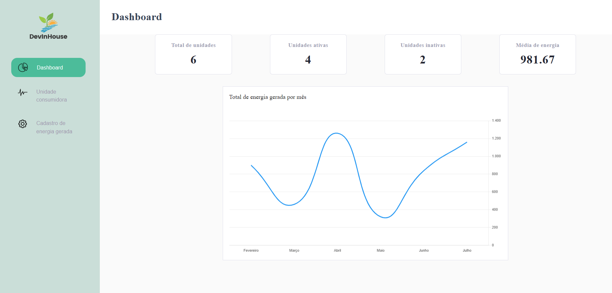
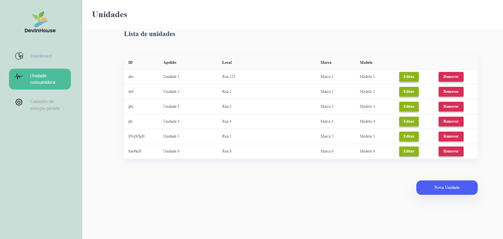
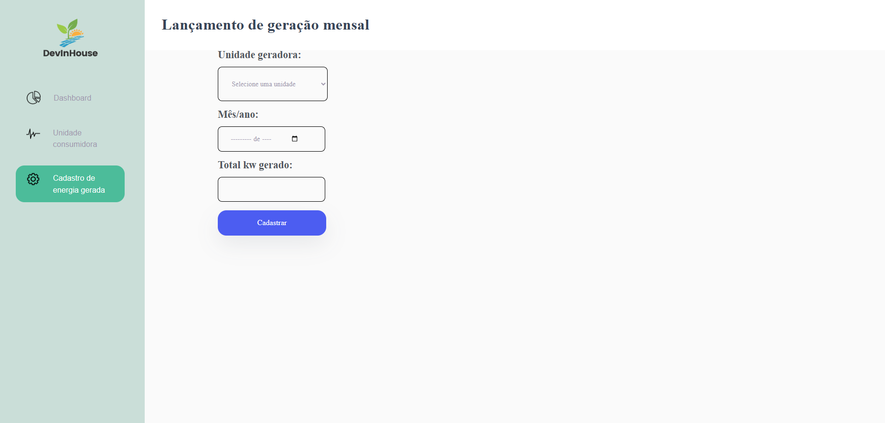

# ☀️ Solar Energy

Aplicação web para **gerenciamento de unidades geradoras de energia solar**: cadastro das unidades, lançamento da geração mensal em kW e um dashboard com indicadores e gráfico de evolução.

Projeto desenvolvido no módulo M3S1 do **FuturoDEV [Ingleses] — SENAI-SC**.


---

## 📸 Telas

### Dashboard
Cards com o total de unidades, unidades ativas e inativas e a média de energia gerada. Ao clicar em um card, o gráfico é filtrado pelas unidades correspondentes.



### Unidades
Listagem das unidades geradoras com as opções de editar, remover e cadastrar uma nova unidade.



### Lançamento de geração mensal
Formulário para registrar quanto cada unidade gerou em determinado mês.



---

## ✨ Funcionalidades

- **CRUD completo de unidades geradoras** (criar, listar, editar e remover) consumindo uma API REST
- **Lançamento de geração mensal** vinculado a uma unidade, com validação de campos obrigatórios
- **Dashboard com indicadores** calculados a partir dos dados da API
- **Gráfico de linha** com o total de energia gerada nos últimos 6 meses, usando Chart.js
- **Filtro interativo**: os cards do dashboard filtram o gráfico por unidades ativas, inativas ou todas
- **Navegação SPA** com React Router e destaque do item ativo no menu
- **Testes automatizados** de componentes com Jest e Testing Library

---

## 🛠️ Tecnologias

| Camada | Ferramentas |
| --- | --- |
| Interface | React 18, Vite, CSS |
| Rotas | React Router DOM 6 |
| Gráficos | Chart.js + react-chartjs-2 |
| API simulada | JSON Server |
| Requisições | Fetch API |
| Testes | Jest, Testing Library (React, User Event, Jest DOM), Babel |
| Qualidade | ESLint |

---

## 🧱 Arquitetura

Os componentes foram organizados seguindo o **Atomic Design**, do menor para o maior nível de composição:

```
src/
├── components/
│   ├── atomos/        # Button, Input
│   ├── moleculas/     # Card, Menu
│   ├── organismos/    # Cards, Chart, UnitList, UnitRegister
│   └── templates/     # Container (layout base das páginas)
├── pages/             # Dashboard, Unidades, Geracoes
├── utils/             # Requisições e agrupamento dos dados por mês
└── assets/            # Logo e ícones
backend/
└── db.json            # Base de dados do JSON Server
```

Essa organização facilita o reaproveitamento: o mesmo `Button` e o mesmo `Input` são usados em todos os formulários, e o `Container` garante o layout padrão de todas as páginas.

---

## 🔌 API

A API é simulada com o **JSON Server** em `http://localhost:3333`, a partir do arquivo `backend/db.json`.

| Método | Endpoint | Descrição |
| --- | --- | --- |
| GET | `/unidades` | Lista as unidades |
| POST | `/unidades` | Cadastra uma unidade |
| PUT | `/unidades/:id` | Atualiza uma unidade |
| DELETE | `/unidades/:id` | Remove uma unidade |
| GET | `/geracoes` | Lista os lançamentos de geração |
| POST | `/geracoes` | Registra a geração mensal de uma unidade |

<details>
<summary>Exemplo de dados</summary>

```json
{
  "unidades": [
    {
      "id": "abc",
      "apelido": "Unidade 1",
      "local": "Rua 123",
      "marca": "Marca 1",
      "modelo": "Modelo 1",
      "ativa": true
    }
  ],
  "geracoes": [
    {
      "id": "123",
      "unidade": "abc",
      "data": "2023-01",
      "total": 100
    }
  ]
}
```

</details>

---

## 🚀 Como rodar

**Pré-requisito:** Node.js 18 ou superior.

```bash
# 1. Clone o repositório
git clone https://github.com/Cristina-Freitas/SolarEnergyCris.git
cd SolarEnergyCris

# 2. Instale as dependências
npm install
```

Em seguida, abra **dois terminais** na pasta do projeto:

```bash
# Terminal 1 — API (http://localhost:3333)
npm run server
```

```bash
# Terminal 2 — aplicação (http://localhost:5173)
npm run dev
```

Acesse `http://localhost:5173` no navegador.

### Testes

```bash
npm test
```

Os testes cobrem a renderização e a navegação do menu, a listagem de unidades e o formulário de cadastro de unidades.

---

## 📚 O que aprendi

- Componentizar uma interface com **Atomic Design** e reaproveitar componentes entre páginas
- Consumir uma **API REST** com `fetch`, usando os métodos GET, POST, PUT e DELETE
- Gerenciar estado e efeitos com os hooks `useState` e `useEffect`
- Transformar dados brutos em informação visual (agrupamento por mês e gráfico com Chart.js)
- Escrever **testes de componentes** com Jest e Testing Library, praticando TDD
- Estruturar rotas de uma SPA com React Router

---

## 🔭 Próximos passos

- [ ] Tela de login com autenticação
- [ ] Atualizar a lista automaticamente após cadastrar, editar ou remover uma unidade
- [ ] Ordenar o gráfico por mês **e ano**, e não apenas pelo mês
- [ ] Mensagens de sucesso e de erro nas requisições
- [ ] Layout responsivo para telas menores
- [ ] Ampliar a cobertura de testes para o dashboard e o lançamento de geração

---

## 👩‍💻 Autora

**Cristina Freitas**

[](https://www.linkedin.com/in/cristina-freitas-fln/)
[](https://github.com/Cristina-Freitas)

---

Este projeto está sob a licença MIT. Veja o arquivo [LICENSE](LICENSE) para mais detalhes.
